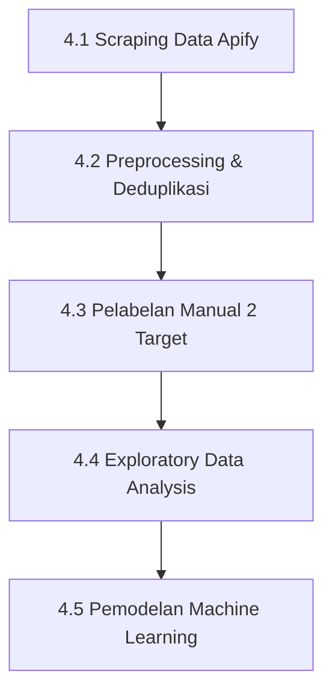

# Analisis Sentimen Publik terhadap Program Kartu Sumbawa Pintar (KSP)

Dokumentasi komprehensif alur pengolahan data (*data pipeline*), analisis eksplorasi, pelabelan, hingga pemodelan machine learning untuk **Analisis Sentimen Publik terhadap Program Kartu Sumbawa Pintar (KSP) Kabupaten Sumbawa**.

---

## 📌 Daftar Isi (*Table of Contents*)

- [1. Judul & Deskripsi Singkat](#-1-judul--deskripsi-singkat)
- [2. Latar Belakang & Metodologi Ringkas](#-2-latar-belakang--metodologi-ringkas)
- [3. Sumber Data & Struktur Dataset Utama](#-3-sumber-data--struktur-dataset-utama)
  - [3.1 Daftar 16 URL Facebook & Peta Akun Sumber](#31-daftar-16-url-facebook--peta-akun-sumber)
  - [3.2 Struktur Kolom Dataset Terstandar (14 Kolom)](#32-struktur-kolom-dataset-terstandar-14-kolom)
- [4. Alur Pipeline Project Secara Berurutan](#-4-alur-pipeline-project-secara-berurutan)
  - [4.1 Scraping Komentar Facebook](#41-scraping-komentar-facebook)
  - [4.2 Preprocessing & Deduplikasi Data](#42-preprocessing--deduplikasi-data)
  - [4.3 Pelabelan Manual 2 Target (Kategori Isu & Sentimen)](#43-pelabelan-manual-2-target-kategori-isu--sentimen)
  - [4.4 Exploratory Data Analysis (EDA)](#44-exploratory-data-analysis-eda)
  - [4.5 Modelling & Tuning Klasifikasi Teks](#45-modelling--tuning-klasifikasi-teks)
- [5. Struktur Folder Project](#-5-struktur-folder-project)
- [6. Cara Menjalankan Project](#-6-cara-menjalankan-project)

---

## 📝 1. Judul & Deskripsi Singkat

**Nama Project:** Analisis Sentimen Publik terhadap Program Kartu Sumbawa Pintar (KSP)  
**Konteks:** Penelitian Skripsi Mahasiswa

Program Kartu Sumbawa Pintar (KSP) merupakan salah satu program prioritas Pemerintah Kabupaten Sumbawa yang mengalokasikan anggaran sebesar **Rp7,54 Miliar kepada 459 mahasiswa** penerima beasiswa/bantuan pendidikan. Project ini bertujuan untuk menganalisis opini, tanggapan, dan sentimen masyarakat di media sosial terhadap implementasi program KSP guna menghasilkan temuan empiris serta rekomendasi strategis bagi pemerintah daerah dalam melakukan perbaikan dan evaluasi kebijakan program di masa mendatang.

---

## 🔬 2. Latar Belakang & Metodologi Ringkas

Penelitian ini mengacu secara sistematis pada dokumen metodologi resmi (`documents/Metodologi_Penelitian_Sentimen_KSP.docx`) yang menerapkan pendekatan campuran (*mixed methods*). Pendekatan tersebut menggabungkan dua alur utama:
1. **Analisis Komentar Publik Media Sosial (Facebook):** Mengkaji secara kualitatif dan kuantitatif persepsi warganet Sumbawa menggunakan teknik Pemrosesan Bahasa Alami (*Natural Language Processing*) dan Machine Learning.
2. **Survei Skala Likert (1-5):** Evaluasi tingkat kepuasan langsung dari mahasiswa penerima manfaat program KSP.

> [!NOTE]
> Dokumentasi dalam `README.md` ini dan seluruh notebook pendukung berfokus penuh pada **alur analisis komentar publik (Facebook)** dari tahap ekstraksi data hingga evaluasi model machine learning.

---

## 🗃️ 3. Sumber Data & Struktur Dataset Utama

Data primer komentar publik diperoleh dari platform Facebook pada berbagai jenis unggahan (informasi resmi Prokopim Sumbawa, rilis media lokal, keterangan Bupati/pejabat daerah, postingan diskusi grup warganet, dan repost personal warga). 

Pengumpulan dilakukan pada **16 URL postingan/reels Facebook** yang memenuhi kriteria penentu memiliki **>5 Komentar**.

### 3.1 Daftar 16 URL Facebook & Peta Akun Sumber

| No | URL Postingan Facebook | Akun Sumber Postingan |
|---|---|---|
| 1 | `https://web.facebook.com/share/v/1CbMB5dHSV/` | Liputan Sumbawa |
| 2 | `https://web.facebook.com/share/p/17tjeersj7/` | Sumbawa Infoo |
| 3 | `https://web.facebook.com/share/p/1HzTaLLRra/` | SAMAWA LAWYER CLUB |
| 4 | `https://web.facebook.com/share/p/1DQLzLvQaa/` | Syarafuddin Jarot |
| 5 | `https://web.facebook.com/share/p/14pCZ7PF3ZF/` | Abdi-nha Wibawa |
| 6 | `https://web.facebook.com/share/p/1E4KsBA74z/` | Semaras.Sia |
| 7 | `https://web.facebook.com/share/p/1J2itfBprs/` | Agustina Sukardi |
| 8 | `https://web.facebook.com/share/p/1FLq2K2Y5N/` | Sahril Imran |
| 9 | `https://web.facebook.com/share/v/1L1TkDXWXM/` | Iwan Sofian |
| 10 | `https://web.facebook.com/share/p/1D582FxEeZ/` | Prokopim Sumbawa |
| 11 | `https://web.facebook.com/share/p/1FAweV127P/` | Fajar Rachmat |
| 12 | `https://web.facebook.com/share/p/1HUK6a9QkS/` | Faisal Salim Al Atas |
| 13 | `https://web.facebook.com/share/p/1Kvm1Mxe6W/` | Nununglusiyana |
| 14 | `https://web.facebook.com/share/p/1JKSaFDCkr/` | Boerhan Samawarea |
| 15 | `https://web.facebook.com/share/p/1dxhBJCKfb/` | Belum diketahui |
| 16 | `https://web.facebook.com/share/p/1F7s4wJHmT/` | Belum diketahui |

---

### 3.2 Struktur Kolom Dataset Terstandar (14 Kolom)

Seluruh komentar disesuaikan ke dalam struktur **14 kolom terstandar** sesuai spesifikasi Metodologi Penelitian KSP:

| No Kolom | Nama Kolom | Tipe Data | Penjelasan / Aturan Pengolahan |
|---|---|---|---|
| 1 | `No` | Integer | Nomor urut data (1 s.d. N) |
| 2 | `Tanggal` | String (YYYY-MM-DD) | Tanggal komentar diunggah dalam zona waktu WITA (`Asia/Makassar`) |
| 3 | `Platform/Sumber` | String | Nilai konstan: `"Facebook"` |
| 4 | `Nama Akun` | String | Nama akun pengunggah (`author/name` atau `profileName`) |
| 5 | `Isi Komentar` | String | Teks komentar warganet apa adanya |
| 6 | `Link Sumber` | String | URL postingan Facebook asal komentar |
| 7 | `Jenis` | String | `"Komentar Utama"` (jika kedalaman = 0) atau `"Balasan"` |
| 8 | `Jumlah_Like` | Integer | Jumlah suka (*likes*) pada komentar |
| 9 | `Jumlah_Balasan` | Integer | Jumlah balasan (*replies*) pada komentar |
| 10 | `Waktu_Komentar_WITA` | String (YYYY-MM-DD HH:MM:SS) | Timestamp lengkap zona waktu WITA (`Asia/Makassar` / UTC+8) |
| 11 | `Akun_Sumber_Postingan` | String | Nama halaman/akun pemilik postingan hasil pemetaan URL |
| 12 | `Kategori Isu` | String | Label isu target (*Apresiasi, Doa/Harapan, Prosedur, Kritik, dll*) |
| 13 | `Sentimen` | String | Label sentimen target (*Positif, Negatif, Netral*) |
| 14 | `Catatan Analis` | String | Catatan kualitatif kontekstual dari analis data |

---

## ⚙️ 4. Alur Pipeline Project Secara Berurutan

Alur pengerjaan pengolahan data dan analisis dibangun secara bertahap dan terukur melalui alur berikut:



### 4.1 Scraping Komentar Facebook
- **Alat & Layanan:** *Apify Facebook Comments Scraper*.
- **Lokasi Simpan:** `data/dataset/`
- **Berkas Mentah:**
  1. `dataset_facebook-comments-scraper_2026-07-27_05-16-43-920.csv` (167 baris)
  2. `dataset_facebook-comments-scraper_2026-07-27_07-45-29-790.csv` (199 baris)
  3. `dataset_facebook-comments-scraper_2026-07-27_11-34-39-617.csv` (222 baris)
- **Total Baris Mentah:** **588 baris komentar**.

---

### 4.2 Preprocessing & Deduplikasi Data
- **File / Script Eksekusi:** Modul Python `notebook/clean_preprocessing.py` & Jupyter Notebook `notebook/preprocessing.ipynb`.
- **Tahapan Pembersihan:**
  1. **Pembersihan Komentar Kosong:** Menghapus baris tanpa teks (`dropna` pada teks komentar).
  2. **Deduplikasi Tingkat 1 (ID Unik):** Menghapus komentar duplikat berdasarkan ID unik bawaan Facebook -> **481 baris**.
  3. **Standarisasi Waktu:** Mengonversi timestamp UTC ke WITA (`Asia/Makassar` / UTC+8).
  4. **Deduplikasi Tingkat 2 (Spam / Akun & Waktu Sama):** Deduplikasi berbasis kombinasi `Nama Akun` + `Isi Komentar Clean` + `Tanggal` -> **475 baris bersih** disimpan di `data/proceed_dataset/Data_Komentar_KSP_fix.xlsx` & `.csv`.
  5. **Deduplikasi Dataset Pelabelan:** Preservasi label komentar unik -> **473 baris bersih final** disiapkan di `data/data_labelling/Data_Komentar_KSP_labelling.xlsx`.

---

### 4.3 Pelabelan Manual 2 Target (Kategori Isu & Sentimen)
- **File / Script Eksekusi:** Workbook kerja Excel `data/data_labelling/Data_Komentar_KSP_labelling.xlsx` & file hasil pelabelan `data/data_labelling/data_labelled.xlsx`.
- **Fitur Bantuan Excel:** Dilengkapi *Data Validation dropdown menu*, aturan kondisional penandaan warna, sheet `Panduan Labeling`, serta kata kunci bantu otomatis.
- **Dua Target Pelabelan:**
  1. **Target 1: Kategori Isu (8 Kategori Resmi):**
     - *Apresiasi/Dukungan*
     - *Doa/Harapan*
     - *Pertanyaan Prosedur & Persyaratan*
     - *Klarifikasi Cakupan Program*
     - *Kritik/Keluhan*
     - *Permohonan Bantuan Pribadi*
     - *Interaksi Sosial Antar Warganet*
     - *Tidak Relevan/Tidak Jelas*
  2. **Target 2: Sentimen (3 Kelas):**
     - *Positif*
     - *Negatif*
     - *Netral*

---

### 4.4 Exploratory Data Analysis (EDA)
- **File / Script Eksekusi:** Jupyter Notebook `notebook/eda.ipynb`.
- **Cakupan Analisis:**
  - **Validasi Label:** Memastikan tidak ada nilai hilang (*missing values*) pada 473 komentar terlabeli.
  - **Distribusi Univariat & Bivariat:** Visualisasi proporsi Kategori Isu, Sentimen, serta matriks hubungan silang keduanya.
  - **Analisis Engagement:** Evaluasi distribusi *Likes* dan *Replies* berdasarkan Kategori Isu dan Sentimen untuk mengukur isu mana yang paling memicu respon publik.
  - **Analisis Tren Temporal:** Pola fluktuasi komentar bulanan/harian terkait rilis pengumuman program KSP.
  - **Analisis Teks:** Ekstraksi kata kunci paling sering muncul (*n-grams*) dan *WordCloud* per kelas sentimen.
  - **Rekomendasi Program:** Sintesis temuan EDA menjadi rekomendasi perbaikan sosialisasi, transparansi kriteria, dan alur pendaftaran KSP bagi Pemkab Sumbawa.

---

### 4.5 Modelling & Tuning Klasifikasi Teks
- **File / Script Eksekusi:** Jupyter Notebook `notebook/modelling.ipynb`.
- **Metodologi Pemodelan:**
  - Ekstraksi Fitur Teks: `TfidfVectorizer` (TF-IDF).
  - Algoritma Yang Diuji (4 Klasifikator): **Support Vector Machine (SVM)**, **Multinomial Naive Bayes**, **K-Nearest Neighbors (KNN)**, dan **Random Forest**.
  - Tuning Hyperparameter: `RandomizedSearchCV` dengan *Stratified 5-Fold Cross Validation*.
  - Metrik Evaluasi Utama: **F1 Macro** (dipilih karena menangani ketidakseimbangan kelas / *imbalanced data* dengan lebih adil).
- **Hasil Evaluasi & Model Terbaik:**
  - **Kategori Isu (8 Kelas):** Model Terbaik = **SVM** (Accuracy: 69.47%, F1 Macro: **0.6594**).
  - **Sentimen (3 Kelas):** Model Terbaik = **Multinomial Naive Bayes** (Accuracy: 73.68%, F1 Macro: **0.6293**).
- **Model Persistence (Folder `notebook/model/`):**
  - `best_model_kategori_isu_svm.joblib`
  - `best_model_sentimen_naive_bayes.joblib`
  - `summary_kategori_isu.csv`
  - `summary_sentimen.csv`

---

## 📁 5. Struktur Folder Project

Berikut adalah struktur direktori aktual proyek `Analisis Sentimen_KSP`:

```text
Analisis Sentimen_KSP/
├── README.md                                   # Dokumentasi utama proyek skripsi
├── SET_UP.md                                   # Panduan teknis instalasi, dependensi, & alur running
├── data/                                       # Direktori manajemen dataset
│   ├── README.md                               # Dokumentasi khusus struktur subfolder data
│   ├── dataset/                                # Folder dataset mentah hasil scraping Apify (3 CSV)
│   │   ├── dataset_facebook-comments-scraper_2026-07-27_05-16-43-920.csv
│   │   ├── dataset_facebook-comments-scraper_2026-07-27_07-45-29-790.csv
│   │   └── dataset_facebook-comments-scraper_2026-07-27_11-34-39-617.csv
│   ├── proceed_dataset/                        # Folder dataset bersih hasil deduplikasi bertingkat
│   │   ├── Data_Komentar_KSP_fix.csv           # File dataset bersih format CSV (475 baris)
│   │   └── Data_Komentar_KSP_fix.xlsx          # File dataset bersih format Excel (475 baris)
│   └── data_labelling/                         # Folder kerja pelabelan komentar
│       ├── Data_Komentar_KSP_labelling.xlsx    # Template Excel kerja pelabelan (473 baris)
│       └── data_labelled.xlsx                  # Dataset final terlabeli penuh (473 baris)
├── documents/                                  # Dokumen acuan metodologi & template awal
│   ├── Metodologi_Penelitian_Sentimen_KSP.docx # Dokumen pedoman metodologi penelitian KSP
│   └── Template_Tabular_Analisis_Sentimen_KSP.xlsx # Template standar 14 kolom analisis
├── notebook/                                   # Kode program Python & Jupyter Notebook
│   ├── clean_preprocessing.py                  # Modul Python preprocessing, WITA, & deduplikasi
│   ├── eda.ipynb                               # Jupyter Notebook Exploratory Data Analysis
│   ├── modelling.ipynb                         # Jupyter Notebook pemodelan machine learning & tuning
│   └── model/                                  # Folder penyimpanan artefak model ML tersimpan
│       ├── best_model_kategori_isu_svm.joblib  # Model tersimpan terbaik Kategori Isu (SVM)
│       ├── best_model_sentimen_naive_bayes.joblib # Model tersimpan terbaik Sentimen (Naive Bayes)
│       ├── summary_kategori_isu.csv            # Hasil evaluasi perbandingan model Kategori Isu
│       └── summary_sentimen.csv                # Hasil evaluasi perbandingan model Sentimen
└── ksp_sumbawa/                                # Virtual environment Python proyek
```

---

## 🛠️ 6. Cara Menjalankan Project

Panduan lengkap mengenai persiapan lingkungan (*virtual environment*), instalasi paket pustaka Python (`pandas`, `numpy`, `scikit-learn`, `joblib`, `matplotlib`, `seaborn`, `wordcloud`), urutan eksekusi script/notebook, serta contoh script inferensi prediksi data komentar baru secara mandiri telah dipisahkan ke dalam berkas khusus:

👉 **[Baca Panduan Setup & Eksekusi Lengkap di SET_UP.md](SET_UP.md)**

### Ringkasan Urutan Eksekusi Singkat:
1. **Aktivasi Environment:** `.\ksp_sumbawa\Scripts\Activate.ps1`
2. **Preprocessing Data:** `python notebook/clean_preprocessing.py`
3. **Exploratory Data Analysis:** `jupyter notebook notebook/eda.ipynb`
4. **Training & Tuning Model:** `jupyter notebook notebook/modelling.ipynb`
5. **Inference / Prediksi Data Baru:** Menggunakan model tersimpan pada folder `notebook/model/`.
