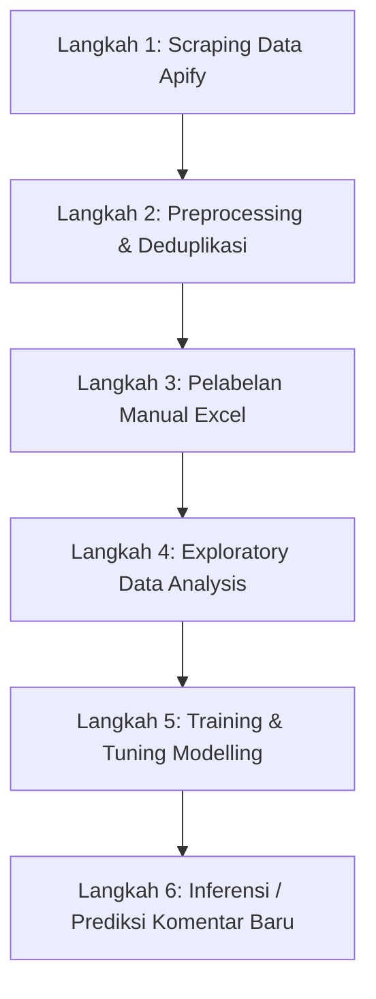

# Panduan Setup & Eksekusi Project (SET_UP.md)

Dokumen ini berisi instruksi teknis langkah demi langkah untuk menyiapkan lingkungan pengembangan (*environment setup*), menginstal dependensi pustaka Python, serta menguji dan menjalankan seluruh alur proyek (*pipeline*) **Analisis Sentimen Publik terhadap Program Kartu Sumbawa Pintar (KSP)**.

---

## 🛠️ 1. Persyaratan Sistem & Lingkungan (*Environment*)

- **Sistem Operasi:** Windows 10/11
- **Bahasa Pemrograman:** Python 3.8+ (disarankan Python 3.10/3.11)
- **Virtual Environment:** Proyek ini telah dilengkapi dengan virtual environment bernama `ksp_sumbawa`.

### Cara Mengaktifkan Virtual Environment di Windows PowerShell:
Buka PowerShell di folder *root* proyek (`Analisis Sentimen_KSP`), lalu jalankan:

```powershell
.\ksp_sumbawa\Scripts\Activate.ps1
```

*(Jika terjadi isu perizinan script execution di PowerShell, jalankan terlebih dahulu: `Set-ExecutionPolicy -ExecutionPolicy RemoteSigned -Scope Process`)*

---

## 📦 2. Instalasi Dependensi / Library Utama

Seluruh dependensi pustaka Python yang digunakan dalam proyek ini dapat diinstal secara sekaligus menggunakan `pip`.

Jalankan perintah berikut pada terminal yang aktif:

```bash
pip install pandas numpy openpyxl scikit-learn joblib matplotlib seaborn wordcloud jupyter
```

### Rincian Dependensi & Penggunaannya:
- **`pandas`**: Pengolahan data tabular, manipulasi DataFrame, membaca/menulis CSV & Excel.
- **`numpy`**: Operasi numerik dan penanganan nilai hilang (*missing values*).
- **`openpyxl`**: Modul pembaca dan penulis format Excel `.xlsx` (diperlukan untuk file pelabelan).
- **`scikit-learn`**: Ekstraksi fitur teks (`TfidfVectorizer`), algoritma ML (SVM, Naive Bayes, KNN, Random Forest), hyperparameter tuning (`RandomizedSearchCV`), dan metrik evaluasi.
- **`joblib`**: Serialisasi dan pemuatan model terkonfigurasi (*export/import .joblib*).
- **`matplotlib` & `seaborn`**: Visualisasi grafik distribusi, heatmap, chart bivariate, dan tren waktu pada EDA.
- **`wordcloud`**: Visualisasi awan kata dari teks komentar warganet.
- **`jupyter`**: Lingkungan eksekusi notebook interaktif (`.ipynb`).

---

## 🚀 3. Urutan Eksekusi Project (*Execution Pipeline*)

Alur proyek dijalankan secara runtut dari awal (pengumpulan data mentah) hingga pengujian model tersimpan.



---

### Langkah 1: Pengumpulan Data Scraping
- Data komentar di-scrape dari 16 URL postingan/reels Facebook terkait program KSP menggunakan **Apify Facebook Comments Scraper**.
- Hasil scraping disimpan pada direktori:
  `data/dataset/`
  1. `dataset_facebook-comments-scraper_2026-07-27_05-16-43-920.csv`
  2. `dataset_facebook-comments-scraper_2026-07-27_07-45-29-790.csv`
  3. `dataset_facebook-comments-scraper_2026-07-27_11-34-39-617.csv`

---

### Langkah 2: Preprocessing & Pembersihan Data
Proses ini menggabungkan 3 file CSV mentah (588 baris), mengonversi waktu UTC ke WITA (`Asia/Makassar`), memetakan tautan URL ke pemilik postingan, serta melakukan deduplikasi bertingkat.

Jalankan modul preprocessing via terminal:
```bash
python notebook/clean_preprocessing.py
```
*Atau buka dan jalankan seluruh sel pada notebook:* `notebook/preprocessing.ipynb`

**Output yang Dihasilkan:**
- `data/proceed_dataset/Data_Komentar_KSP_fix.csv` & `.xlsx` (475 baris bersih)
- `data/data_labelling/Data_Komentar_KSP_labelling.xlsx` (473 baris siap dilabeli)

---

### Langkah 3: Pelabelan Manual Komentar
- Buka file `data/data_labelling/Data_Komentar_KSP_labelling.xlsx` menggunakan Microsoft Excel.
- Terdapat 3 sheet: `Panduan Labeling`, `Data Komentar`, dan `Referensi`.
- Isikan **Kategori Isu** (8 kategori) dan **Sentimen** (Positif, Negatif, Netral) pada setiap komentar.
- Simpan file yang telah dilabeli penuh sebagai `data/data_labelling/data_labelled.xlsx`.

---

### Langkah 4: Exploratory Data Analysis (EDA)
Jalankan Jupyter Notebook untuk menganalisis distribusi label, interaksi *engagement* (likes/replies), analisis temporal, serta ekstraksi temuan rekomendasi:

```bash
jupyter notebook notebook/eda.ipynb
```
*Di dalam Jupyter Notebook, pilih menu **Kernel** -> **Restart & Run All**.*

---

### Langkah 5: Pelatihan & Tuning Model Klasifikasi
Jalankan notebook klasifikasi teks untuk melatih 4 algoritma (SVM, Naive Bayes, KNN, Random Forest) menggunakan TF-IDF Vectorizer dan RandomizedSearchCV tuning:

```bash
jupyter notebook notebook/modelling.ipynb
```
*Pilih menu **Kernel** -> **Restart & Run All**.*

**Output Model Tersimpan (`notebook/model/`):**
- `best_model_kategori_isu_svm.joblib` (Model terbaik Kategori Isu, F1 Macro: 0.6594)
- `best_model_sentimen_naive_bayes.joblib` (Model terbaik Sentimen, F1 Macro: 0.6293)
- `summary_kategori_isu.csv` & `summary_sentimen.csv` (Tabel perbandingan performa model)

---

### Langkah 6: Inferensi / Prediksi Komentar Baru
Gunakan model terlatih yang tersimpan pada folder `notebook/model/` untuk mengklasifikasikan komentar baru secara otomatis tanpa perlu melatih ulang model.

Contoh script Python inferensi:

```python
import joblib

# 1. Muat model tersimpan
model_kategori = joblib.load("notebook/model/best_model_kategori_isu_svm.joblib")
model_sentimen = joblib.load("notebook/model/best_model_sentimen_naive_bayes.joblib")

# 2. Contoh data komentar baru dari Facebook
komentar_baru = [
    "Bagaimana cara pendaftaran Kartu Sumbawa Pintar untuk mahasiswa luar daerah?",
    "Alhamdulillah bantuan KSP sudah cair sangat membantu biaya kuliah saya",
    "Pencairan sangat lambat dan tidak jelas informasinya kecewa sekali"
]

# 3. Lakukan prediksi
pred_kategori = model_kategori.predict(komentar_baru)
pred_sentimen = model_sentimen.predict(komentar_baru)

# 4. Tampilkan hasil
for teks, kat, sen in zip(komentar_baru, pred_kategori, pred_sentimen):
    print(f"Komentar : {teks}")
    print(f"Kategori : {kat}")
    print(f"Sentimen : {sen}")
    print("-" * 50)
```

---

## 🔍 Penanganan Kendala (*Troubleshooting*)

1. **`ModuleNotFoundError` (misal: `No module named 'joblib'`):**
   Pastikan virtual environment `ksp_sumbawa` sudah diaktifkan sebelum menjalankan script/notebook, atau instal library melalui `pip install <nama_module>`.
2. **Path File Tidak Ditemukan (`FileNotFoundError`):**
   Pastikan perintah eksekusi dijalankan dari folder *root* proyek (`Analisis Sentimen_KSP`), bukan dari dalam subfolder `notebook/`.
